YOO
# Akshaj This side 
currently working on LLMs, system designs, APIs and end to end deployable system pipelines

  

###

###

    
    
  

###

<picture data-importer="pacman">
  <source media="(prefers-color-scheme: dark)" srcset="https://raw.githubusercontent.com/ospreyboi/ospreyboi/pacman-output/galaga-contribution-graph-dark.svg?game=galaga">
  <source media="(prefers-color-scheme: light)" srcset="https://raw.githubusercontent.com/ospreyboi/ospreyboi/pacman-output/galaga-contribution-graph.svg?game=galaga">
  
</picture>

###

  
  
  
  
  
  
  
  
  
  
  
  
  
  
  
  
  
  
  
  
  
  
  
  
  
  
  

###

  

